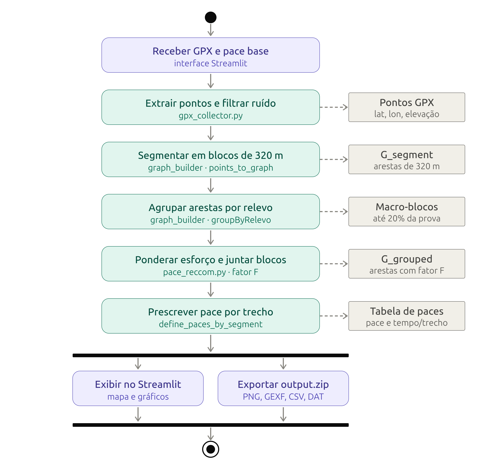
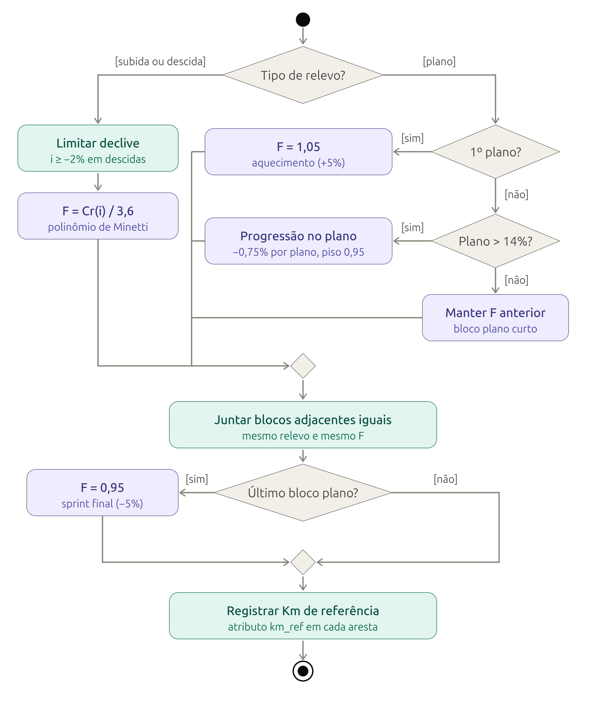
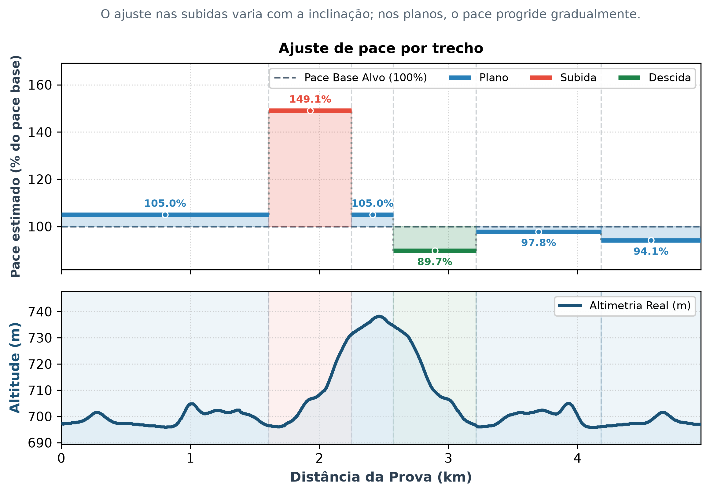
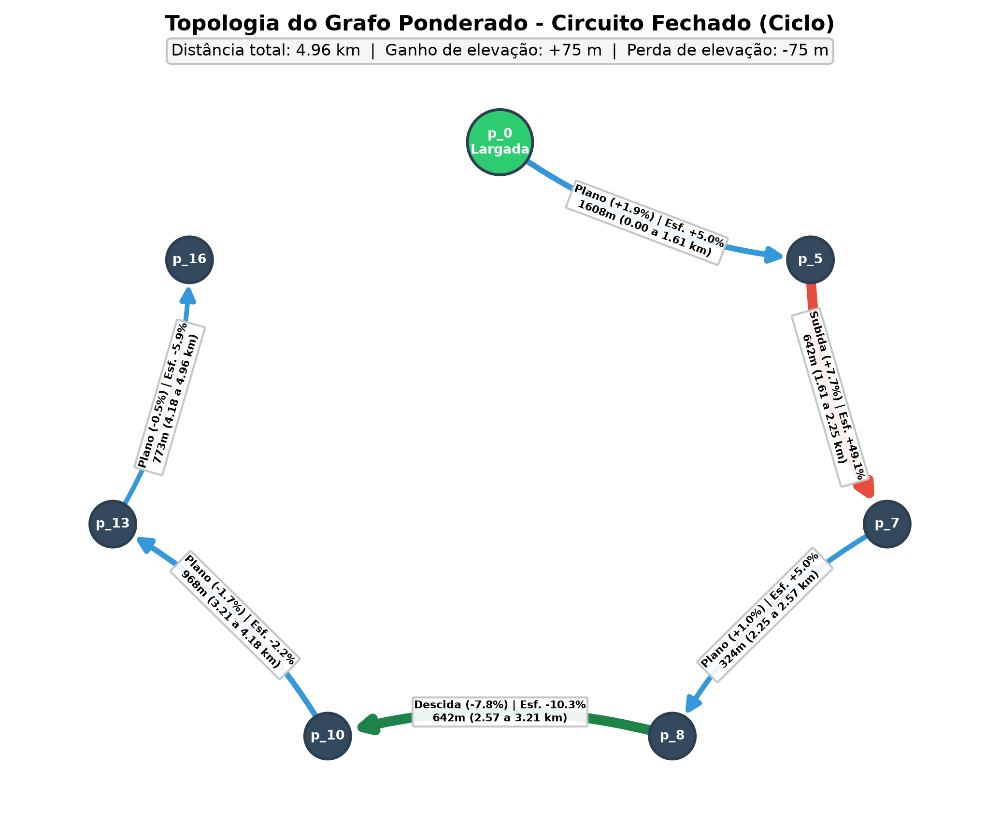

<div align="center">

# 🏃 Sistema de Recomendação de Pace com Parâmetros de Elevação

**Modelagem de Percursos GPX em Grafos Direcionados Ponderados e Prescrição de Ritmo Baseada no Custo Metabólico de Minetti**

[](https://www.python.org/)
[](https://ubuntu.com/)
[](https://streamlit.io/)
[](https://networkx.org/)
[](https://doi.org/10.5281/zenodo.23809922)

[Sobre o Projeto](#-sobre-o-projeto) •
[Fluxo Algorítmico](#-arquitetura-e-fluxo-algorítmico) •
[Modelagem Matemática](#-modelagem-matemática-e-regras-de-prescrição) •
[Complexidade](#-complexidade-e-escalabilidade) •
[Resultados](#-resultados-rota-corrida-viveza) •
[Como Executar](#-como-executar-no-linux-ubuntu-2404) •
[Referências](#-referências-científicas)

</div>

---

## 📌 Identificação Acadêmica

| Campo | Descrição |
| :--- | :--- |
| **Instituição** | Centro Federal de Educação Tecnológica de Minas Gerais (CEFET-MG) — Campus V (Divinópolis) |
| **Disciplina** | Estruturas em Árvores e Teoria dos Grafos |
| **Autores** | **Felipe Silva** (`felipe.silva@aluno.cefetmg.br`) & **Prof. Michel Pires da Silva** (`michel@cefetmg.br`) |
| **Dataset Oficial** | [Zenodo — DOI: 10.5281/zenodo.23809922](https://doi.org/10.5281/zenodo.23809922) |
| **Repositório** | [github.com/Felipe0132/Pace-Recommender-By-Route](https://github.com/Felipe0132/Pace-Recommender-By-Route) |

---

## 🎯 Sobre o Projeto

No planejamento de corridas de rua, a divisão tradicional do ritmo (*pace*, em $\text{min/km}$) por quilômetros fechados ou frações fixas da distância funciona bem em percursos planos, mas perde precisão quando o trajeto apresenta variações de relevo. Manter a mesma velocidade em subidas e descidas exige esforços fisiológicos muito distintos.

Enquanto o **GAP (*Grade Adjusted Pace*)** tradicional converte o *pace* realizado em uma inclinação qualquer para o ritmo equivalente em terreno plano, este projeto aplica a **operação inversa para o planejamento pré-prova**: a partir de um *pace* base informado para o plano, o sistema mapeia a rota GPX como um **grafo direcionado ponderado** $G = (V, E)$, agrupa o percurso em segmentos topográficos inteligentes e prescreve o *pace* ideal para cada trecho.

### Principais Funcionalidades
- **Extração e filtragem GPX:** Leitura sequencial de latitude, longitude e elevação com remoção de pontos consecutivos duplicados.
- **Modelagem em grafo direcionado (`NetworkX`):** Representação compacta em que os vértices demarcam fronteiras topográficas e as arestas acumulam distância horizontal, altimetria, quilometragem de referência (`km_ref`), classe de relevo e fator de esforço.
- **Cálculo metabólico e biomecânico:** Ajuste de ritmo baseado no polinômio de 5ª ordem de **Minetti et al. (2002)**, combinado a regras de aquecimento, progressão em planos, sprint final e trava de segurança articular em descidas.
- **Visualização e exportação completa (`output.zip`):** Mapa interativo Folium/Leaflet, curva de pace vs. perfil altimétrico (Altair e Matplotlib), diagrama topológico do grafo, exportação nativa pré-configurada para o **Gephi (`.gexf`)**, tabela `.csv` e relatório `.dat`.

---

## 🔄 Arquitetura e Fluxo Algorítmico

Os diagramas de atividades abaixo detalham o ciclo de vida completo da solução, desde a leitura do arquivo GPX até a ponderação do fator de esforço ($F$) e fusão das arestas no grafo:

<table>
  <tr>
    <td align="center" width="50%">
      <br/>
      <sub><b>Figura 1:</b> Diagrama de atividades do fluxo geral de construção do grafo e prescrição de <i>pace</i>.</sub>
    </td>
    <td align="center" width="50%">
      <br/>
      <sub><b>Figura 2:</b> Diagrama de atividades do cálculo do fator de esforço (<i>F</i>), fusão de blocos equivalentes e registro de quilometragem.</sub>
    </td>
  </tr>
</table>

---

## 📐 Modelagem Matemática e Regras de Prescrição

### 1. Distância Geodésica de Haversine e Segmentação Inicial ($\ge 320\text{ m}$)
Para cada par de pontos consecutivos do arquivo GPX, a distância horizontal $d$ (em metros) é calculada pela **fórmula de Haversine** sobre as coordenadas em radianos ($\phi$ = latitude, $\lambda$ = longitude, $R = 6371\text{ km}$):

$$d = 2R \arcsin\left(\sqrt{\sin^2\left(\frac{\Delta\phi}{2}\right) + \cos(\phi_k)\cos(\phi_{k+1})\sin^2\left(\frac{\Delta\lambda}{2}\right)}\right)$$

Os deslocamentos são acumulados até atingir ou ultrapassar o limiar de **$320\text{ m}$** (`TRHESHOLD_DIST = 320`), fechando uma aresta no grafo inicial (`G_segment`). A inclinação fracionária $i$ e percentual $i_{\%}$ do bloco são obtidas pela variação líquida de altitude ($\Delta z$) entre seus extremos:

$$i = \frac{\Delta z}{d}, \qquad i_{\%} = i \times 100$$

Cada bloco recebe uma classificação topográfica:
- **🔺 Subida (Aclive):** $i_{\%} \ge +3\%$
- **🔻 Descida (Declive):** $i_{\%} < -3\%$
- **➖ Plano:** $-3\% \le i_{\%} < +3\%$

---

### 2. Contração de Arestas em Duas Fases (`G_grouped`)
1. **Agrupamento Estrutural (Teto de 20% da Rota):** Arestas adjacentes de mesma classe de relevo são fundidas enquanto a soma de suas distâncias não exceder **20% da distância total da prova**. A inclinação representativa atribuída ao grupo é a de **maior valor absoluto** ($\max |i_{\%}|$) entre seus blocos originais.
2. **Fusão Pós-Fator:** Após o cálculo do fator de esforço de cada grupo, blocos vizinhos de mesma classe cujos fatores coincidam até a 4ª casa decimal são unidos em uma única super-aresta, recalculando a distância acumulada, a inclinação máxima e o marcador quilométrico (`Km início a fim`).

---

### 3. Polinômio de Minetti et al. (2002) e Regras de Calibração
O custo energético relativo da corrida $C_r(i)$ (em $\text{J}\cdot\text{kg}^{-1}\cdot\text{m}^{-1}$) em função da inclinação fracionária $i$ é estimado pelo polinômio de quinto grau de Minetti et al. (2002):

$$C_r(i) = 155,4i^5 - 30,4i^4 - 43,3i^3 + 46,3i^2 + 19,5i + 3,6$$

A razão entre $C_r(i)$ e o custo basal em terreno plano ($C_r(0) = 3,6\text{ J}\cdot\text{kg}^{-1}\cdot\text{m}^{-1}$) define o fator metabólico $F_e$:

$$F_e = \frac{C_r(i)}{C_r(0)} = \frac{C_r(i)}{3,6}, \qquad P_{\text{seg}} = P_{\text{base}} \times F$$

As quatro regras aplicadas na sequência dos blocos são:
1. **Aquecimento no 1º trecho plano:** O primeiro bloco plano recebe $F = 1,05$ (`+5,0%`), iniciando $5\%$ mais lento que o *pace* base.
2. **Progressão nos planos intermediários (Limiar de 14% da prova):** A distância mínima para progressão é $70\%$ do limite estrutural de agrupamento, o que equivale a **$14\%$ da rota total**. Nos blocos planos seguintes ($k \ge 2$) com extensão $> 14\%$ da prova, o ritmo progride $0,75\%$ por posição com um verificador que trava o piso dos trechos intermediários em $0,95$:
   $$F = \max\big(0,95;\; 1,0 - 0,0075(k - 1)\big)$$
   Blocos planos curtos ($\le 14\%$ da rota) mantêm o fator do bloco plano anterior (e fundem-se a ele caso sejam vizinhos).
3. **Sprint no último trecho plano:** Se houver mais de um segmento plano após a fusão, o último segmento plano recebe um estímulo extra de chegada multiplicando seu fator acumulado por **$0,97$** ($F_{\text{final}} = F \times 0,97$), sem a trava de $0,95$ aplicada aos blocos intermediários.
4. **Limite biomecânico em descidas (`-2%`):** Em declives ($i_{\%} < -3\%$), inclinações inferiores a $-2\%$ são truncadas em $i = -0,02$ antes de avaliar $C_r(i)$, restringindo a redução do *pace* a **`-10,3%`** ($F_e \approx 0,897$) para conter o impacto articular e a sobrecarga excêntrica.

---

## ⚡ Complexidade e Escalabilidade

- **Complexidade de Tempo Linear $O(N + |V| + |E|)$:** A leitura e a segmentação percorrem os $N$ pontos do arquivo GPX uma única vez ($O(N)$), enquanto as etapas de contração e cálculo de ritmo percorrem sequencialmente apenas os vértices e arestas reduzidos ($O(|V| + |E|)$). O tempo de execução mantém-se na faixa de poucos milissegundos.
- **Estabilidade Topológica em Rotas Longas (Base de 5 Segmentos):** Quando a entrada cresce para percursos maiores e com mais pontos (ex.: $10\text{ km}$, $21\text{ km}$ ou $42\text{ km}$), o teto de agrupamento acompanha proporcionalmente a prova ($20\%$ da distância total). Assim, caso o percurso não tenha mudança de relevo, os blocos de $320\text{ m}$ são contraídos em uma **base de 5 segmentos** (cada um com $\approx 20\%$ da prova). Quando há subidas e descidas, apenas as transições de relevo geram subdivisões adicionais sobre essa base, evitando a explosão de vértices e mantendo um plano enxuto para o corredor.

---

## 📊 Resultados: Rota "Corrida Viveza"

No processamento do arquivo `in/Corrida_Viveza.gpx` (distância de **$4.956\text{ m}$**, ganho e perda acumulados de elevação de **$75\text{ m}$** cada) para um *pace* base de **`05:30 min/km`** ($330\text{ s/km}$), o algoritmo consolidou a rota em **6 segmentos**, com tempo total previsto de **`28:47`** e *pace* médio de **`05:48 min/km`** (`+5,6%`):

| Trecho | Km Referência | Relevo | Distância (m) | Inclinação (%) | Ajuste / Esforço (%) | Pace Sugerido | Tempo no Trecho |
| :--- | :---: | :--- | :---: | :---: | :---: | :---: | :---: |
| **Segmento #1** | Km 0.00 a 1.61 | ➖ Plano | 1608 | +1,9% | +5,0% | 05:46 min/km | 09:17 |
| **Segmento #2** | Km 1.61 a 2.25 | 🔺 Subida | 642 | +7,7% | +49,1% | 08:12 min/km | 05:15 |
| **Segmento #3** | Km 2.25 a 2.57 | ➖ Plano | 324 | +1,0% | +5,0% | 05:46 min/km | 01:52 |
| **Segmento #4** | Km 2.57 a 3.21 | 🔻 Descida | 642 | -7,8% | -10,3% | 04:55 min/km | 03:09 |
| **Segmento #5** | Km 3.21 a 4.18 | ➖ Plano | 968 | -1,7% | -2,2% | 05:22 min/km | 05:12 |
| **Segmento #6** | Km 4.18 a 4.96 | ➖ Plano | 773 | -0,5% | -5,9% | 05:10 min/km | 04:00 |
| **🏁 Total / Geral** | **Km 0.00 a 4.96** | **—** | **4956** | **—** | **+5,6%** | **05:48 min/km** | **28:47** |

### Gráficos Exportados pelo Sistema (`out/imagens/`)

<div align="center">
  <br/>
  <sub><b>Figura 3:</b> Curva de <i>pace</i> recomendado por trecho (% do <i>pace</i> base) no painel superior e perfil altimétrico com faixas de relevo no painel inferior.</sub>
</div>

<br/>

<div align="center">
  <br/>
  <sub><b>Figura 4:</b> Topologia em anel do grafo direcionado ponderado gerada para o circuito da Corrida Viveza.</sub>
</div>

---

## 📂 Estrutura de Diretórios

```text
Recomendacao-de-Pace/
├── in/
│   └── Corrida_Viveza.gpx                 # Rota GPX real de exemplo (4.956 m)
├── out/                                   # Artefatos gerados na execução (também exportados via output.zip)
│   ├── imagens/
│   │   ├── curva_pace_relevo.png          # Gráfico estático de pace vs. altimetria (300 DPI)
│   │   ├── grafo_topologia.png            # Imagem da topologia do grafo direcionado
│   │   ├── uml_atividades_fluxo_geral_pace.png
│   │   └── uml_atividades_fator_de_esforco.png
│   ├── grafo_gephi.gexf                   # Grafo XML estruturado com atributos VIZ para o Gephi
│   ├── tabela_ritmo_recomendado.csv       # Tabela consolidada de prescrição por segmento
│   └── output.dat                         # Relatório textual consolidado da execução
├── src/
│   ├── collectors/
│   │   └── gpx_collector.py               # Leitura de trilhas GPX (gpxpy) e filtragem de duplicados
│   ├── core/
│   │   └── graph_builder.py               # Segmentação (>= 320 m), contração (<= 20%) e grafo NetworkX
│   ├── models/
│   │   └── pace_reccom.py                 # Polinômio de Minetti, regras de progressão, sprint e fusão
│   ├── services/
│   │   └── route_services.py              # Orquestração da pipeline, exportação GEXF e pacote output.zip
│   ├── views/
│   │   ├── chart_view.py                  # Mapas Folium, gráficos interativos Altair e plots Matplotlib
│   │   └── download_view.py               # Componente de download único do pacote output.zip
│   ├── Enums/
│   │   └── enum.py                        # Enumerações de relevo (TipoRelevo) e paleta de cores
│   └── utils/
│       └── utils.py                       # Haversine, equação de Minetti e formatação de DataFrames
├── main.py                                # Aplicação principal em Streamlit
├── requirements.txt                       # Dependências Python do projeto
└── README.md                              # Documentação técnica do repositório
```

---

## 🚀 Como Executar no Linux (Ubuntu 24.04)

### Pré-requisitos
- **Sistema Operacional:** Linux (compatível com Ubuntu 24.04 LTS)
- **Python:** `3.10` ou superior (`python3 --version`)

### Passo a Passo via Terminal

```bash
# 1. Clonar o repositório
git clone https://github.com/Felipe0132/Pace-Recommender-By-Route.git
cd Pace-Recommender-By-Route

# 2. Criar e ativar o ambiente virtual (venv)
python3 -m venv venv
source venv/bin/activate

# 3. Instalar as dependências listadas
pip install -r requirements.txt

# 4. Iniciar a aplicação via terminal
streamlit run main.py
```

Após executar o comando acima, a interface abrirá automaticamente no navegador padrão em `http://localhost:8501`. Na tela inicial:
1. Defina o **Pace base no plano** (ou use os botões `-5s` / `+5s`).
2. Escolha entre enviar um arquivo `.gpx` próprio ou selecionar **"Testar com trajeto de exemplo (Viveza)"**.
3. Clique em **"Confirmar pace e calcular"** para visualizar o mapa, o grafo, os gráficos e baixar o pacote `output.zip`.

---

## 🛣️ Trabalhos Futuros (Roadmap)

- [ ] **Integração com a API do Strava:** Extração automática do *pace* base do corredor em terreno plano e calibração individualizada das taxas de perda em subidas e de progressão em planos a partir do histórico de treinos.
- [ ] **Segmentação Topográfica Adaptativa (*Change-Point Detection*):** Substituição do corte espacial fixo de $320\text{ m}$ pela detecção automática de pontos de inflexão na série altimétrica suavizada, instanciando vértices exatamente no início e no fim de cada rampa para evitar a diluição de subidas curtas entre blocos vizinhos.
- [ ] **Validação Experimental em Campo:** Ensaios práticos com corredores voluntários no percurso da Corrida Viveza, confrontando o ritmo prescrito com o ritmo realizado, frequência cardíaca e percepção subjetiva de esforço.

---

## 📚 Referências Científicas

1. **Minetti, A. E., Moia, C., Roi, G. S., Susta, D., & Ferretti, G. (2002).** *Energy cost of walking and running at extreme uphill and downhill slopes*. **Journal of Applied Physiology**, vol. 93, no. 3, pp. 1039–1046. DOI: [`10.1152/japplphysiol.01177.2001`](https://doi.org/10.1152/japplphysiol.01177.2001).
2. **Diestel, R. (2017).** *Graph Theory*, 5th ed. Berlin, Germany: **Springer**.
3. **Gottschall, J. S., & Kram, R. (2005).** *Ground reaction forces during downhill and uphill running*. **Journal of Biomechanics**, vol. 38, no. 3, pp. 445–452. DOI: [`10.1016/j.jbiomech.2004.04.023`](https://doi.org/10.1016/j.jbiomech.2004.04.023).
4. **Vernillo, G., Giandolini, M., Edwards, W. B., Morin, J.-B., Samozino, P., Horvais, N., & Millet, G. Y. (2017).** *Biomechanics and physiology of uphill and downhill running*. **Sports Medicine**, vol. 47, no. 4, pp. 615–629. DOI: [`10.1007/s40279-016-0605-y`](https://doi.org/10.1007/s40279-016-0605-y).
5. **Silva, F., & Silva, M. P. (2026).** *Dataset para otimização de rotas de corrida e modelagem de esforço baseado em grafos*. **Zenodo**. DOI: [`10.5281/zenodo.23809922`](https://doi.org/10.5281/zenodo.23809922).

<details>
<summary><b>📌 Como citar este projeto (BibTeX)</b></summary>

```bibtex
@misc{silva2026pace,
  author       = {Silva, Felipe and Silva, Michel Pires da},
  title        = {Sistema de Recomenda{\c{c}}{\~a}o de Pace com Par{\^a}metros de Eleva{\c{c}}{\~a}o},
  institution  = {CEFET-MG Campus V},
  address      = {Divin{\'o}polis, Brasil},
  year         = {2026},
  doi          = {10.5281/zenodo.23809922},
  url          = {https://github.com/Felipe0132/Pace-Recommender-By-Route}
}
```
</details>
